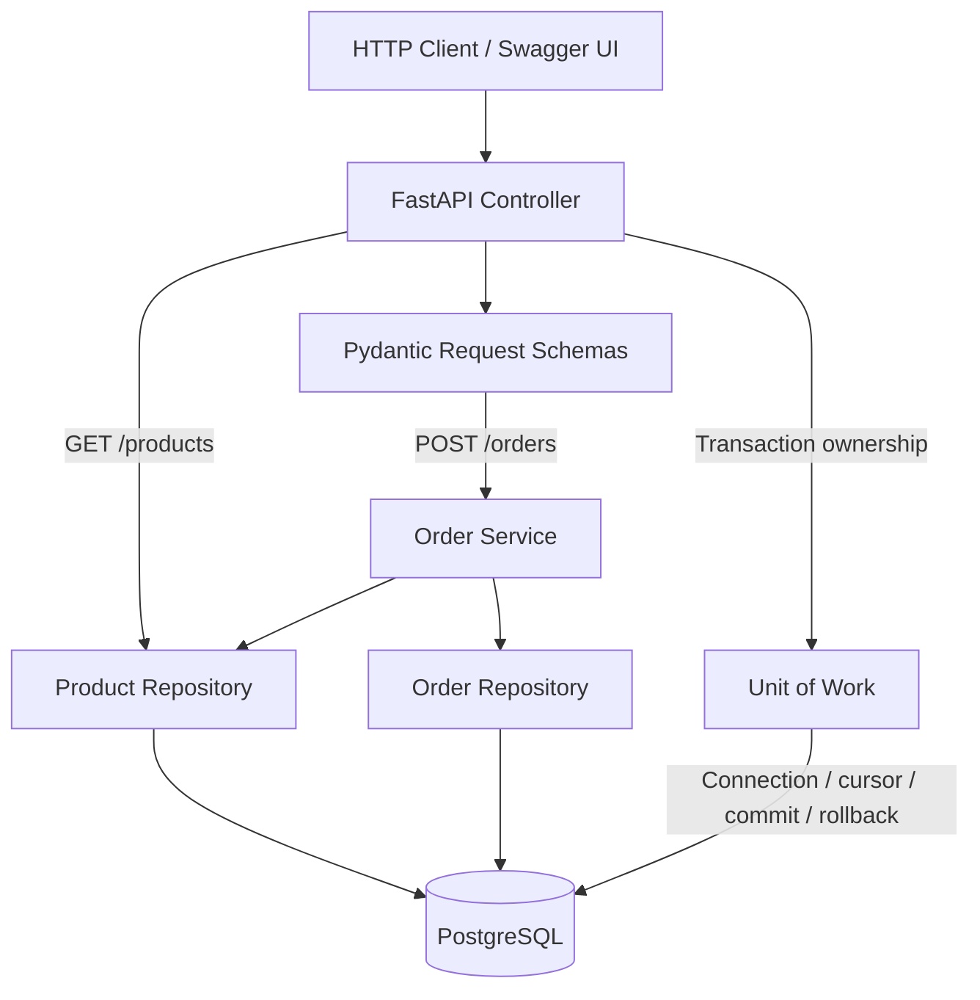
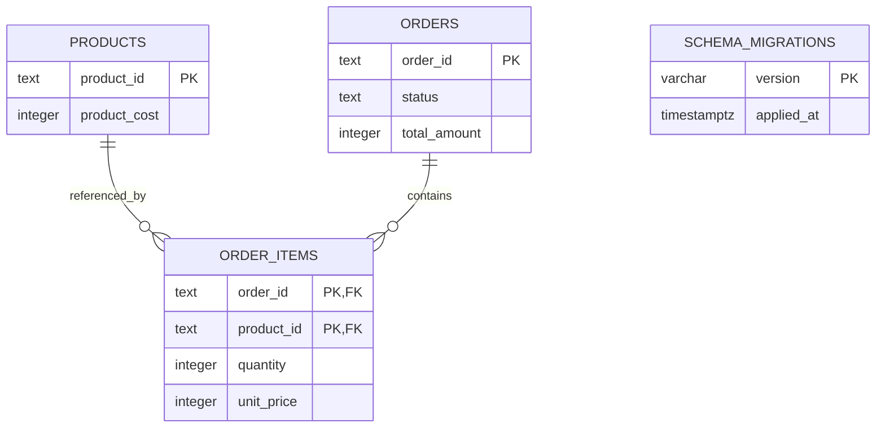

# E-commerce Order Processing API

[English](README.md) | [Tiếng Việt](README_vi.md)

A backend REST API for e-commerce order processing, built with Python, FastAPI and PostgreSQL. The project demonstrates layered application design, request validation, database-backed pricing, transactional order creation and integration testing with a real database.

This is a learning and portfolio project focused on backend correctness and maintainability, not a complete production e-commerce platform.

## Features

- Health endpoint and product lookup by multiple product IDs.
- Strict request validation with Pydantic, including duplicate product detection.
- Server-side product lookup and price calculation; prices are not accepted from the client as authoritative input.
- UUID-based order identifiers and a default `PENDING_PAYMENT` status.
- Atomic creation of orders and order items using an explicit Unit of Work.
- Parameterized SQL queries through psycopg2.
- PostgreSQL running in Docker with persistent storage, version-tracked migration and repeatable seed execution.
- HTTP integration tests and transaction verification scripts.

## Technology stack

| Component | Technology |
| --- | --- |
| Language | Python 3.14 (development environment) |
| API | FastAPI, Uvicorn |
| Validation | Pydantic v2 |
| Database | PostgreSQL 16 |
| Database access | psycopg2 (installed via `psycopg2-binary`) |
| Configuration | python-dotenv |
| Infrastructure | Docker Compose |
| Testing | unittest, FastAPI TestClient, httpx |

## Architecture



The controller handles HTTP requests, response mapping and transaction boundaries. The service handles business logic and calls repositories. Repositories execute parameterized SQL using a caller-provided cursor; they do not own connections or commit transactions. `UnitOfWork` manages the connection, cursor and transaction for order creation. Product lookup uses a direct, explicitly closed database connection.

### Order creation workflow

1. Validate the request and reject duplicate product IDs.
2. Generate an `ORD-` identifier using UUID4.
3. Extract unique product IDs and fetch prices in one query using `ANY(%s)`.
4. Build an in-memory price lookup dictionary and verify that every requested product exists.
5. Calculate each subtotal and the total amount, preserving the input item order.
6. Insert the order and its items using the same database transaction.
7. Commit only after the service succeeds, then return HTTP 201.

Missing products raise `ProductNotFound`, which the controller maps to HTTP 404. Other unexpected exceptions are not converted into 404 responses. On exiting the Unit of Work, any uncommitted work is rolled back and database resources are closed. The rollback does not undo a completed commit.

## Project structure

```text
ecommerce_order_api_backend/
├── app/
│   ├── main.py
│   ├── core/
│   │   └── config.py
│   ├── db/
│   │   ├── db_connection.py
│   │   └── unit_of_work.py
│   ├── products/
│   │   └── repository.py
│   └── orders/
│       ├── schemas.py
│       ├── service.py
│       └── repository.py
├── database/
│   ├── migration/
│   │   └── 001_create_tables.sql
│   └── seeds/
│       └── 001_seed_products.sql
├── scripts/
│   ├── migrate.py
│   ├── run_seed.py
│   ├── check_db_connection.py
│   ├── check_prepare_order.py
│   └── check_order_repository.py
├── tests/
│   └── integration/
│       ├── test_uow_commit.py
│       ├── test_uow_exception.py
│       ├── test_create_order_service.py
│       └── test_http_orders.py
├── .env.example
├── .gitignore
├── compose.yml
├── requirements.txt
├── README.md
└── README_vi.md
```

Package markers and generated files are omitted from the tree for clarity.

## Database schema



- `products`: product identifier and integer price.
- `orders`: order identifier, status (default `PENDING_PAYMENT`) and total amount.
- `order_items`: composite primary key (`order_id`, `product_id`), foreign keys to both parent tables, quantity and price at order creation.
- `schema_migrations`: records the applied migration version and timestamp.

Subtotals are calculated by the service and returned in the API response; they are not separate database columns. All price and amount values use integer units; no currency conversion is implemented.

Seed products:

| Product ID | Product cost |
| --- | ---: |
| P101 | 100000 |
| P102 | 50000 |

## Getting started

### 1. Prerequisites

Install Python (the project was developed with 3.14), Git, and Docker with Docker Compose v2. Start Docker Desktop or the Docker daemon. The API runs on the host; only PostgreSQL is containerized.

Clone this repository using its GitHub clone URL, then open a terminal in the project root (`ecommerce_order_api_backend`). All commands below are run from that directory.

### 2. Install dependencies

Windows CMD:

```bat
python -m venv .venv
.venv\Scripts\activate
python -m pip install -r requirements.txt
copy .env.example .env
```

Linux/macOS alternative:

```bash
python3 -m venv .venv
source .venv/bin/activate
python -m pip install -r requirements.txt
cp .env.example .env
```

### 3. Configure environment variables

Edit `.env` before starting PostgreSQL. Example for local development (replace the password placeholder):

```dotenv
DB_HOST=localhost
DB_PORT=5433
DB_NAME=ecommerce_api
DB_USER=user
DB_PASSWORD=replace_with_your_local_password
```

| Variable | Purpose |
| --- | --- |
| `DB_HOST` | PostgreSQL hostname from the host machine |
| `DB_PORT` | Published PostgreSQL port (`5433`) |
| `DB_NAME` | Database name |
| `DB_USER` | Database user |
| `DB_PASSWORD` | Database password |

Docker Compose reads the database name, user and password from `.env`. Python entry points load `.env` through python-dotenv. `get_env()` validates the required values and port range.

Keep `.env` private and commit only `.env.example`. Changing `POSTGRES_PASSWORD` after the database volume has already been initialized does not change the existing database user's password; use matching credentials for the initialized database. The host port is mapped to container port 5432 in `compose.yml`.

### 4. Start PostgreSQL, migrate and seed

```bash
docker compose up -d
docker compose ps
docker compose exec postgres pg_isready
```

Wait until PostgreSQL accepts connections, then run:

```bash
python -m scripts.migrate
python -m scripts.run_seed
python -m scripts.check_db_connection
```

Expected on a fresh database:

```text
MIGRATION 001: APPLIED
SEEDED PRODUCTS
DB_CONNECTED: TRUE
PRODUCTS: [('P101', 100000), ('P102', 50000)]
```

The migration runner skips version `001_create_tables` if already applied. The seed uses `ON CONFLICT (product_id) DO NOTHING`, so existing products are not overwritten. PostgreSQL data is stored in the named volume `ecommerce_api_data` (Compose may prefix its actual name with the project name).

### 5. Start the API

```bash
python -m uvicorn app.main:app --reload
```

- API: <http://127.0.0.1:8000>
- Swagger UI: <http://127.0.0.1:8000/docs>
- OpenAPI: <http://127.0.0.1:8000/openapi.json>

For local development only. To stop the API, press Ctrl+C. To stop the database while retaining the named volume, run `docker compose down`. Do not use `down -v` unless you intentionally want to delete local database data.

## API reference

| Method | Endpoint | Description | Success status |
| --- | --- | --- | --- |
| GET | `/health` | Application liveness (not a database readiness probe) | 200 |
| GET | `/products?product_ids=P101&product_ids=P102` | Fetch existing products by repeated query parameters | 200 |
| POST | `/orders/validate` | Validate request shape and duplicate IDs; no DB access | 200 |
| POST | `/orders` | Validate, calculate and persist an order | 201 |

### GET /health

```json
{"status":"ok","service":"ecommerce-api"}
```

### GET /products

Request: `GET /products?product_ids=P101&product_ids=P102`

```json
{
  "products": [
    {"productId": "P101", "productCost": 100000},
    {"productId": "P102", "productCost": 50000}
  ]
}
```

Products are returned in ascending product ID order. Unknown IDs are omitted. If none exists, the response is `{"products": []}` with HTTP 200. The `product_ids` query parameter is required.

### POST /orders/validate and POST /orders

Both accept this request body:

```json
{
  "items": [
    {"productId": "P101", "quantity": 2},
    {"productId": "P102", "quantity": 3}
  ]
}
```

`POST /orders/validate` returns HTTP 200:

```json
{"valid": true, "item_count": 2}
```

This endpoint validates the input schema only; it does not check product existence or write to the database.

`POST /orders` returns HTTP 201 after a successful commit:

```json
{
  "orderId": "ORD-96b1d220-f907-40bf-945f-0a95555331ce",
  "amount": 350000,
  "order_items": [
    {
      "product_id": "P101",
      "quantity": 2,
      "unit_price": 100000,
      "subtotal": 200000
    },
    {
      "product_id": "P102",
      "quantity": 3,
      "unit_price": 50000,
      "subtotal": 150000
    }
  ]
}
```

The UUID shown is illustrative; each successful request generates a new identifier. The default order status is stored in PostgreSQL, not returned by this endpoint.

### Validation and errors

| Condition | HTTP status |
| --- | --- |
| Missing product in `POST /orders` | 404 |
| Empty items, missing required fields, blank product ID | 422 |
| Quantity zero, negative, string or boolean | 422 |
| Duplicate product ID | 422 |
| Unexpected internal failure | 500 (default server error behavior) |

A missing product returns:

```json
{"detail": "product_id P999 not found"}
```

Validation errors use FastAPI's standard `detail` array. Invalid requests do not create orders in the tested failure paths.

## Testing

Use a dedicated local test database with the migration applied and the expected seed prices. Stop concurrent writers while running tests that compare table row counts. Do not run these integration tests against production data.

### Automated HTTP integration suite

```bash
python -m unittest tests.integration.test_http_orders -v
```

The suite contains four test methods:

| Test | Verification |
| --- | --- |
| `test_create_order_success` | HTTP 201, total 350000, two response items and persisted rows queried by returned order ID |
| `test_product_not_found` | HTTP 404, exact error detail and unchanged row counts |
| `test_duplicate_product` | HTTP 422, duplicate validation message and unchanged row counts |
| `test_invalid_request_validation` | Eight `subTest` cases, HTTP 422, validation detail and unchanged row counts |

The eight regression cases cover empty items, zero/negative quantities, string/boolean quantities, whitespace-only product IDs, and missing product ID or quantity.

The success test registers `addCleanup()` using the returned order ID before checking the response body. Cleanup deletes child rows first, then the parent order, and commits. It also runs if a later assertion fails.

Expected suite summary:

```text
Ran 4 tests
OK
```

The HTTP tests use TestClient in-process and a real PostgreSQL database; a separate Uvicorn process is not required. The eight subtests belong to one test method, not eight additional methods.

### Additional executable checks

```bash
python -m scripts.check_prepare_order
python -m scripts.check_order_repository
python -m tests.integration.test_create_order_service
python -m tests.integration.test_uow_exception
python -m tests.integration.test_uow_commit
```

These verify pricing and missing-product handling, repository rollback, service integration, exception-triggered rollback, and commit persistence through a new connection. Run them individually as modules. The commit check uses a new UUID each time and intentionally leaves its committed order in the local database. The other transaction checks use rollback or read-only operations.

## Scope and limitations

- Focused on order creation and product lookup; no authentication, authorization, payment gateway, inventory reservation, order lifecycle updates or frontend.
- No connection pooling, production deployment configuration, observability pipeline or CI workflow is included.
- Request validation is implemented at the API boundary; the database schema does not independently enforce every business rule. Prices and amounts are stored as PostgreSQL integers.
- Repeated successful API requests create new orders; no idempotency key is implemented.
- Dependencies are currently unpinned in `requirements.txt`. Locking versions and providing an isolated test database would improve reproducibility.
- The development Compose port mapping and Uvicorn reload mode are not hardened for public deployment.

