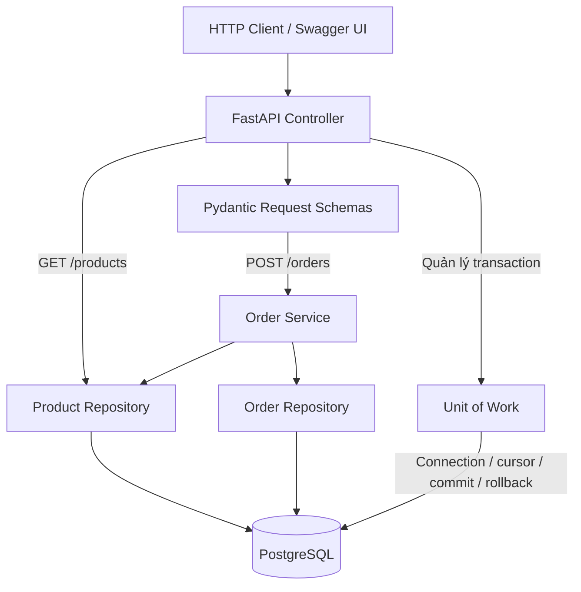
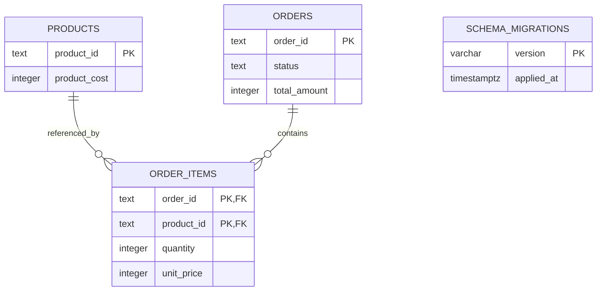

# E-commerce Order Processing API

[English](README.md) | [Tiếng Việt](README_vi.md)

REST API backend xử lý đơn hàng thương mại điện tử, xây dựng bằng Python, FastAPI và PostgreSQL. Dự án minh họa kiến trúc phân tầng, kiểm tra dữ liệu đầu vào, tính giá từ cơ sở dữ liệu, tạo đơn hàng theo transaction và kiểm thử tích hợp với database thật.

Đây là dự án thực hành và portfolio, tập trung vào tính đúng đắn và khả năng bảo trì của backend, chưa phải nền tảng thương mại điện tử hoàn chỉnh dùng trong production.

## Tính năng

- Health check và truy vấn sản phẩm theo nhiều Product ID.
- Request Validation nghiêm ngặt bằng Pydantic, bao gồm phát hiện Product ID trùng.
- Kiểm tra sản phẩm và tính giá ở backend; không lấy giá do client gửi làm giá chính thức.
- Sinh mã đơn hàng bằng UUID và trạng thái mặc định `PENDING_PAYMENT`.
- Tạo Order và Order Items trong cùng transaction với Unit of Work và COMMIT tường minh.
- Truy vấn SQL parameterized qua psycopg2.
- PostgreSQL chạy bằng Docker, lưu dữ liệu bằng volume, migration có theo dõi version và seed có thể chạy lại.
- HTTP Integration Tests và các script kiểm chứng transaction.

## Công nghệ sử dụng

| Thành phần | Công nghệ |
| --- | --- |
| Ngôn ngữ | Python 3.14 (môi trường phát triển) |
| API | FastAPI, Uvicorn |
| Validation | Pydantic v2 |
| Cơ sở dữ liệu | PostgreSQL 16 |
| Truy cập database | psycopg2 (cài qua `psycopg2-binary`) |
| Cấu hình | python-dotenv |
| Hạ tầng | Docker Compose |
| Kiểm thử | unittest, FastAPI TestClient, httpx |

## Kiến trúc



Controller tiếp nhận HTTP Request, chuyển đổi Response và quản lý ranh giới transaction. Service điều phối nghiệp vụ và gọi Repository. Repository thực thi SQL parameterized thông qua cursor do caller cung cấp, không tự tạo connection hoặc COMMIT. `UnitOfWork` quản lý connection, cursor và transaction khi tạo đơn hàng. API truy vấn sản phẩm sử dụng connection trực tiếp và đóng connection tường minh.

### Luồng tạo đơn hàng

1. Validate request và từ chối Product ID trùng.
2. Sinh mã đơn hàng với prefix `ORD-` bằng UUID4.
3. Trích xuất Product ID duy nhất và truy vấn giá bằng một câu SQL `ANY(%s)`.
4. Tạo dictionary tra cứu giá trong bộ nhớ và kiểm tra toàn bộ sản phẩm tồn tại.
5. Tính subtotal và tổng amount, giữ nguyên thứ tự item đầu vào.
6. INSERT Order và Order Items trong cùng một transaction.
7. COMMIT sau khi Service hoàn thành, rồi trả HTTP 201.

Sản phẩm không tồn tại phát sinh `ProductNotFound`, được Controller chuyển thành HTTP 404. Các exception bất ngờ khác không bị chuyển thành 404. Khi thoát Unit of Work, phần chưa COMMIT được ROLLBACK và tài nguyên database được đóng. ROLLBACK không hoàn tác dữ liệu đã COMMIT thành công.

## Cấu trúc project

```text
ecommerce_order_api_backend/
├── app/
│   ├── main.py
│   ├── core/
│   │   └── config.py
│   ├── db/
│   │   ├── db_connection.py
│   │   └── unit_of_work.py
│   ├── products/
│   │   └── repository.py
│   └── orders/
│       ├── schemas.py
│       ├── service.py
│       └── repository.py
├── database/
│   ├── migration/
│   │   └── 001_create_tables.sql
│   └── seeds/
│       └── 001_seed_products.sql
├── scripts/
│   ├── migrate.py
│   ├── run_seed.py
│   ├── check_db_connection.py
│   ├── check_prepare_order.py
│   └── check_order_repository.py
├── tests/
│   └── integration/
│       ├── test_uow_commit.py
│       ├── test_uow_exception.py
│       ├── test_create_order_service.py
│       └── test_http_orders.py
├── .env.example
├── .gitignore
├── compose.yml
├── requirements.txt
├── README.md
└── README_vi.md
```

Sơ đồ lược bỏ các file đánh dấu package và file sinh tự động để dễ đọc.

## Database Schema



- `products`: mã sản phẩm và giá dạng số nguyên.
- `orders`: mã đơn hàng, trạng thái (mặc định `PENDING_PAYMENT`) và tổng tiền.
- `order_items`: khóa chính ghép (`order_id`, `product_id`), khóa ngoại đến hai bảng cha, số lượng và đơn giá tại thời điểm tạo đơn hàng.
- `schema_migrations`: lưu version migration đã áp dụng và thời điểm thực hiện.

Subtotal được Service tính và trả trong API Response, không phải cột riêng trong database. Giá và tổng tiền sử dụng đơn vị số nguyên; chưa triển khai chuyển đổi tiền tệ.

Dữ liệu seed:

| Product ID | Product cost |
| --- | ---: |
| P101 | 100000 |
| P102 | 50000 |

## Hướng dẫn cài đặt và khởi chạy

### 1. Yêu cầu môi trường

Cài Python (dự án phát triển với 3.14), Git, Docker và Docker Compose v2. Khởi động Docker Desktop hoặc Docker daemon. API chạy trên máy host; chỉ PostgreSQL chạy trong container.

Clone repository bằng URL clone trên GitHub, sau đó mở terminal tại thư mục gốc `ecommerce_order_api_backend`. Tất cả lệnh bên dưới chạy tại thư mục này.

### 2. Cài dependencies

Windows CMD:

```bat
python -m venv .venv
.venv\Scripts\activate
python -m pip install -r requirements.txt
copy .env.example .env
```

Linux/macOS:

```bash
python3 -m venv .venv
source .venv/bin/activate
python -m pip install -r requirements.txt
cp .env.example .env
```

### 3. Cấu hình Environment Variables

Chỉnh file `.env` trước khi khởi động PostgreSQL. Ví dụ cấu hình local (thay placeholder mật khẩu bằng mật khẩu của bạn):

```dotenv
DB_HOST=localhost
DB_PORT=5433
DB_NAME=ecommerce_api
DB_USER=user
DB_PASSWORD=replace_with_your_local_password
```

| Biến | Chức năng |
| --- | --- |
| `DB_HOST` | Hostname PostgreSQL từ máy host |
| `DB_PORT` | Port PostgreSQL trên máy host (`5433`) |
| `DB_NAME` | Tên database |
| `DB_USER` | Database user |
| `DB_PASSWORD` | Mật khẩu database |

Docker Compose đọc tên database, user và password từ `.env`. Các Python entry point nạp `.env` qua python-dotenv. `get_env()` kiểm tra các giá trị bắt buộc và phạm vi port hợp lệ.

Giữ `.env` riêng tư, chỉ commit `.env.example`. Thay `POSTGRES_PASSWORD` sau khi volume database đã được khởi tạo không làm thay đổi mật khẩu database user hiện có; cần dùng thông tin khớp với database đã khởi tạo. Port host được ánh xạ tới port 5432 của container trong `compose.yml`.

### 4. Khởi động PostgreSQL, Migration và Seed

```bash
docker compose up -d
docker compose ps
docker compose exec postgres pg_isready
```

Khi PostgreSQL đã sẵn sàng nhận kết nối, chạy:

```bash
python -m scripts.migrate
python -m scripts.run_seed
python -m scripts.check_db_connection
```

Kết quả mong đợi trên database mới:

```text
MIGRATION 001: APPLIED
SEEDED PRODUCTS
DB_CONNECTED: TRUE
PRODUCTS: [('P101', 100000), ('P102', 50000)]
```

Migration runner bỏ qua version `001_create_tables` nếu đã áp dụng. Seed sử dụng `ON CONFLICT (product_id) DO NOTHING`, không ghi đè các sản phẩm hiện có. Dữ liệu PostgreSQL được lưu trong named volume `ecommerce_api_data` (Compose có thể thêm prefix tên project vào tên volume thực tế).

### 5. Khởi động API

```bash
python -m uvicorn app.main:app --reload
```

- API: <http://127.0.0.1:8000>
- Swagger UI: <http://127.0.0.1:8000/docs>
- OpenAPI: <http://127.0.0.1:8000/openapi.json>

Chỉ dùng cho phát triển local. Dừng API bằng Ctrl+C. Dừng database nhưng giữ dữ liệu trong named volume bằng `docker compose down`. Không dùng `down -v` trừ khi chủ động muốn xóa dữ liệu database local.

## API Contract

| Method | Endpoint | Chức năng | HTTP thành công |
| --- | --- | --- | --- |
| GET | `/health` | Kiểm tra ứng dụng hoạt động (không kiểm tra DB readiness) | 200 |
| GET | `/products?product_ids=P101&product_ids=P102` | Truy vấn sản phẩm theo query parameter lặp lại | 200 |
| POST | `/orders/validate` | Validate cấu trúc request và ID trùng, không truy cập DB | 200 |
| POST | `/orders` | Validate, tính tiền và lưu đơn hàng | 201 |

### GET /health

```json
{"status":"ok","service":"ecommerce-api"}
```

### GET /products

Request: `GET /products?product_ids=P101&product_ids=P102`

```json
{
  "products": [
    {"productId": "P101", "productCost": 100000},
    {"productId": "P102", "productCost": 50000}
  ]
}
```

Sản phẩm được sắp xếp theo Product ID tăng dần. ID không tồn tại sẽ bị bỏ qua. Nếu không tìm thấy sản phẩm nào, trả `{"products": []}` với HTTP 200. Query parameter `product_ids` là bắt buộc.

### POST /orders/validate và POST /orders

Cả hai nhận Request Body:

```json
{
  "items": [
    {"productId": "P101", "quantity": 2},
    {"productId": "P102", "quantity": 3}
  ]
}
```

`POST /orders/validate` trả HTTP 200:

```json
{"valid": true, "item_count": 2}
```

Endpoint này chỉ validate schema đầu vào, không kiểm tra sản phẩm tồn tại và không ghi database.

`POST /orders` trả HTTP 201 sau COMMIT thành công:

```json
{
  "orderId": "ORD-96b1d220-f907-40bf-945f-0a95555331ce",
  "amount": 350000,
  "order_items": [
    {
      "product_id": "P101",
      "quantity": 2,
      "unit_price": 100000,
      "subtotal": 200000
    },
    {
      "product_id": "P102",
      "quantity": 3,
      "unit_price": 50000,
      "subtotal": 150000
    }
  ]
}
```

UUID trên chỉ minh họa; mỗi request thành công tạo mã mới. Trạng thái mặc định của đơn hàng được lưu trong PostgreSQL, không trả trong Response của endpoint này.

### Validation và Error Handling

| Trường hợp | HTTP status |
| --- | --- |
| Sản phẩm không tồn tại trong `POST /orders` | 404 |
| Items rỗng, thiếu field bắt buộc, Product ID chỉ chứa khoảng trắng hoặc rỗng | 422 |
| Quantity bằng 0, âm, string hoặc boolean | 422 |
| Product ID trùng | 422 |
| Lỗi nội bộ bất ngờ | 500 (hành vi mặc định của server) |

Response khi sản phẩm không tồn tại:

```json
{"detail": "product_id P999 not found"}
```

Lỗi validation sử dụng mảng `detail` chuẩn của FastAPI. Các request không hợp lệ không tạo đơn hàng trong những failure path đã kiểm thử.

## Kiểm thử

Sử dụng database local dành riêng cho test, đã chạy migration và có giá seed đúng yêu cầu. Không thực hiện thao tác ghi đồng thời khi chạy các test so sánh số lượng record. Không chạy các integration test này trên dữ liệu production.

### Automated HTTP Integration Tests

```bash
python -m unittest tests.integration.test_http_orders -v
```

Bộ test gồm bốn test method:

| Test | Nội dung kiểm chứng |
| --- | --- |
| `test_create_order_success` | HTTP 201, tổng tiền 350000, hai item trong Response và dữ liệu DB theo Order ID vừa trả về |
| `test_product_not_found` | HTTP 404, thông báo lỗi chính xác và số record không đổi |
| `test_duplicate_product` | HTTP 422, thông báo ID trùng và số record không đổi |
| `test_invalid_request_validation` | Tám trường hợp `subTest`, HTTP 422, validation detail và số record không đổi |

Tám regression cases bao gồm items rỗng, quantity bằng 0/âm, quantity string/boolean, Product ID chỉ chứa khoảng trắng, thiếu Product ID hoặc quantity.

Test thành công đăng ký `addCleanup()` với Order ID lấy từ Response trước khi kiểm tra nội dung Response. Cleanup xóa các dòng con trước, sau đó xóa Order và COMMIT; vẫn chạy khi assertion phía sau thất bại.

Kết quả tổng kết mong đợi:

```text
Ran 4 tests
OK
```

HTTP test dùng TestClient trong cùng process và PostgreSQL thật; không cần chạy Uvicorn riêng. Tám subtest nằm trong một test method, không được tính thành tám method riêng.

### Các script kiểm chứng bổ sung

```bash
python -m scripts.check_prepare_order
python -m scripts.check_order_repository
python -m tests.integration.test_create_order_service
python -m tests.integration.test_uow_exception
python -m tests.integration.test_uow_commit
```

Các bài kiểm chứng gồm tính giá và xử lý sản phẩm không tồn tại, ROLLBACK của Repository, tích hợp Service, ROLLBACK khi có Exception và xác nhận dữ liệu tồn tại sau COMMIT bằng connection mới. Chạy từng module riêng. Bài test COMMIT dùng UUID mới mỗi lần và chủ động giữ đơn hàng đã COMMIT trong database local. Các bài kiểm chứng transaction còn lại sử dụng ROLLBACK hoặc chỉ đọc.

## Phạm vi và giới hạn hiện tại

- Tập trung vào tạo đơn hàng và đọc sản phẩm; chưa có xác thực, phân quyền, thanh toán, giữ tồn kho, cập nhật vòng đời đơn hàng hoặc frontend.
- Chưa có connection pool, cấu hình triển khai production, hệ thống observability hay CI workflow.
- Validation nằm ở API boundary; database schema chưa tự bảo vệ tất cả quy tắc nghiệp vụ. Giá và tổng tiền được lưu dưới dạng PostgreSQL integer.
- Gửi lại request hợp lệ sẽ tạo đơn hàng mới; chưa có idempotency key.
- `requirements.txt` chưa cố định phiên bản. Khóa phiên bản dependencies và cung cấp test database cách ly sẽ tăng khả năng tái lập môi trường.
- Port mapping của Compose và Uvicorn reload phục vụ phát triển local, chưa được harden để triển khai công khai.

